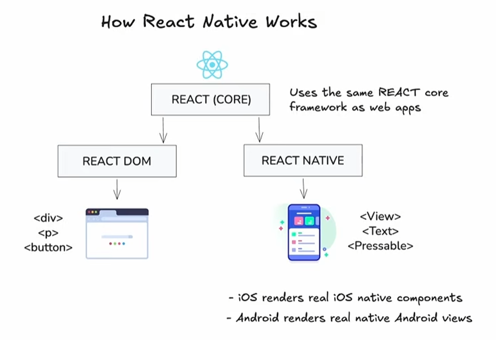
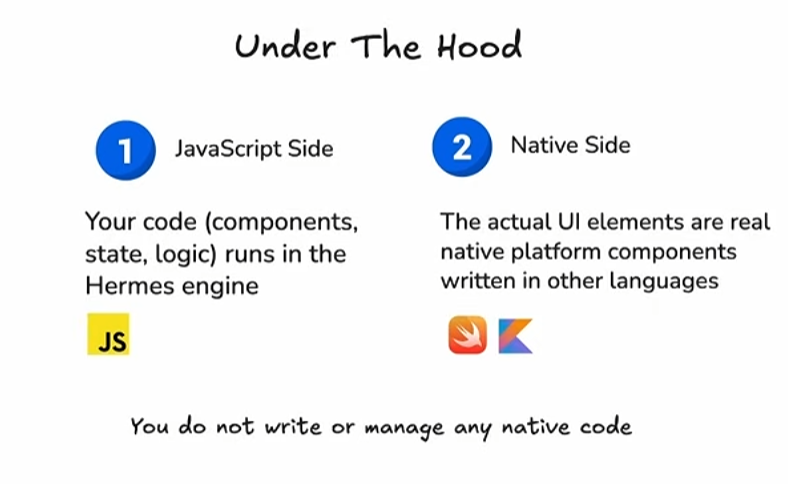
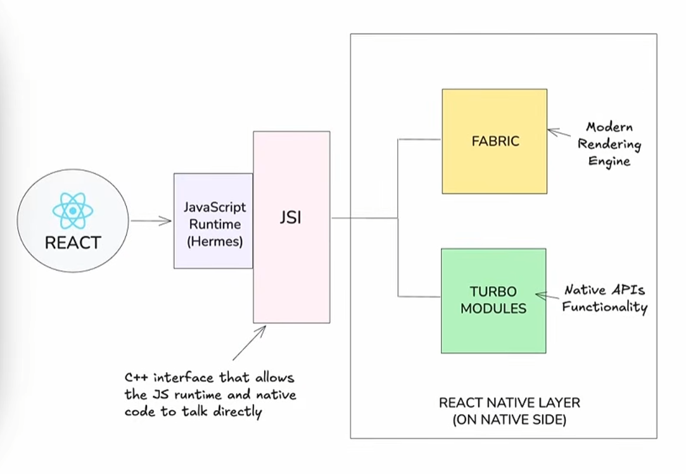

# 1. Applications mobiles multiplateformes

## 1.1 Développement natif vs multi-plateformes

Le développement natif pour iOS ou pour Android permet de développer une application mobile qui :

* respecte l'apparence et les comportements habituels de la plateforme (look and feel)
* offre les meilleures performances
* peut tirer avantage de toutes les fonctionnalités du système d'exploitation natif et de l'appareil utilisé
* utilise un cadre d'application qui est financé et maintenu par l'entreprise qui développe le système d'exploitation (Apple pour iOS et Google pour Android)

Par contre, le développement natif offre des défis :

* temps de développement et de maintenance beaucoup plus élevé si l'application doit être développée séparément pour iOS et pour Android
* difficile de trouver des spécialistes dans l'un et l'autre des environnements
* courbe d'apprentissage abrupte

De façon globale, on pourrait dire que le développement natif est idéal si vous avez une équipe de développeurs bien établie pour chacun des systèmes visés.

Pour sa part, le développement multiplateformes devrait être priorisé si vous avez une petite équipe de développement et des ressources limitées.

## 1.2 Différentes approches pour applications multiplateformes

Les outils qui permettent de développer des applications mobiles pour iOS ou pour Android à l'aide du même code peuvent utiliser différentes approches.

## Coquille autour d'une application Web

* PhoneGap
* Cordova
* Ionic
* Capacitor

Cette approche est intéressante puisqu'elle n'implique pas de développer une nouvelle application mobile. Le même code HTML, CSS et JavaScript sera utilisé pour le site Web, l'application iOS et l'application Android.

Cependant, ceci se fait à un coût :

* Puisque l'application est en fait une coquille autour d'un site Web, l'aspect et le comportement (look and feel) de l'application sera différent des standards de la plateforme.
* Il y aura un petit délai d'exécution puisqu'une couche logicielle doit faire le lien entre le Web et le mobile.
* Il n'est pas possible de travailler avec plus d'un fil d'exécution.

## Pont JavaScript entre l'application et le langage natif

React Native, développé par Facebook en 2015, utilise ce principe.

Les applications React Native offrent des performances qui se rapprochent de celles d'une application native.

 
 

Source: <https://www.youtube.com/watch?v=XCifkDC0yXA>

## Compilation du code en instructions machine

Flutter, développé par Google en 2017, utilise cette approche. Un nouveau langage de programmation, Dart, est utilisé pour développer l'application.

Le code est compilé en directement en instructions machine pour les différentes plateformes.

Les applications Flutter offrent un aspect et un comportement qui se rapprochent de ceux d'une application native.

## Partage de code Kotlin entre plateformes

Kotlin Multiplatform (KMP) partage du code Kotlin entre Android et iOS, généralement la logique métier et l'accès aux données, tout en gardant une interface native pour chaque plateforme. Il est aussi possible de partager l'interface avec Compose Multiplatform, le toolkit d'interface multiplateforme de JetBrains, mais ce partage est facultatif.

Sur Android, le code Kotlin s'exécute sur Android Runtime (ART). Sur iOS, Kotlin/Native le compile en code natif : aucun JVM n'est utilisé.

## Pour plus d'information

* « Top 10 Best Cross-Platform App Development Frameworks ». Tech Ahead. <https://www.techaheadcorp.com/blog/best-cross-platform-app-development-frameworks/>
* « A Comparison of Flutter Vs. React – An Overview ». Techtiz. <https://techtiz.co/blogs/a-comparison-of-flutter-vs-react/>
* « Kotlin Multiplatform ». Kotlin. <https://kotlinlang.org/multiplatform/>