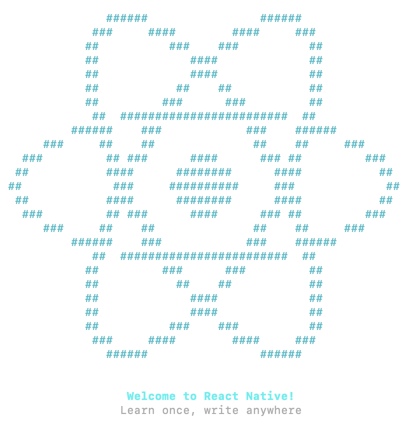

# 2. Installation de React Native

## 2.1 React Native

React Native utilise le langage de programmation JavaScript.

Si vous avez déjà développé une application Web avec React, vous réussirez à coder en React Native rapidement.

Avec React Native, votre code vous permettra de créer une application pour Android et pour iOS mais à certaines conditions.

* Vous aurez besoin d'un ordinateur Apple pour tester et pour publier une application pour iOS.
* Il faudra probablement apporter quelques modifications au code afin de le rendre optimal pour Android ou pour iOS. Le but est d'obtenir une application qui est le plus près de l'apparence et du comportement par défaut de la plateforme.



## Pour plus d'information

* « React Native Beginners Tutorial—A Cold Dive ». Toptal. <https://www.toptal.com/react-native/cold-dive-into-react-native-a-beginners-tutorial>
* « The Ultimate React Native Tutorial ». Simpli Learn. <https://www.simplilearn.com/react-native-tutorial-article>
* « Créer une application React Native ». Grafikart. <https://grafikart.fr/tutoriels/react-native-pokedex-2245> 
* « Formation React ». Dyma. <https://dyma.fr/formations/react>

## 2.2 Installation de React Native via Docker Desktop

Nous allons utiliser Docker Desktop pour créer un environnement de développement qui permettra de bâtir des projets React Native. Le dépôt avec les scripts est : <https://github.com/Apps-Mobiles-2-Victo/react-native-docker-android>.

Vous pouvez utiliser l'éditeur de votre choix pour développer votre application mais vous aurez besoin d'Android Studio pour gérer les *émulateurs*.

Nous n'utiliserons pas [Expo](https://expo.dev/), un écosystème d'outils pour React Native. Pour comprendre ce que l'utilisation d'Expo implique, lisez ceci : <https://upstackhq.com/blog/software-development/should-i-use-expo-for-react-native>.

## Cloner le dépôt { #clone }

Sous WSL, cloner le dépôt puis se placer à sa racine. Tous les scripts ci-dessous s'exécutent depuis cette racine :

```sh
git clone https://github.com/Apps-Mobiles-2-Victo/react-native-docker-android.git
cd react-native-docker-android
```

## Construire l'image Docker { #image }

Depuis la racine du dépôt, construire l'image Docker avec le tag `react-native-android` (à faire une seule fois) :

```sh
./scripts/build-docker-image-wsl.sh
```

!!! warning
    L'image Docker finale utilise près de 7 Go d'espace disque. Assurez-vous d'avoir suffisamment d'espace libre avant de lancer la construction.

## Projet de test Hello World Android { #hello-world }

Un petit projet React Native utilisant Gradle se trouve dans `examples/android-hello-world` du dépôt. Il affiche « Bonjour Android ! » et inclut les bibliothèques natives pour les architectures `x86_64` (pour les émulateurs sur PC).

Depuis la racine du dépôt, construire l'APK autonome (la variante `release` embarque le bundle JavaScript, sans serveur Metro) dans l'image Docker :

```sh
./scripts/build-android-app-wsl.sh
```

Le script conserve le cache Gradle dans le volume Docker `gradle-home-cache` afin de le réutiliser entre les exécutions.

Le fichier produit est `examples/android-hello-world/android/app/build/outputs/apk/release/app-release.apk`.

## Installer et démarrer l'APK sur l'émulateur { #adb }

Pour installer et démarrer l'APK sur l'AVD d'Android Studio depuis WSL, vous devez exposer le serveur ADB Windows sur le réseau commun entre WSL et Windows.

Android Studio démarre son propre serveur ADB, qui ne peut pas être utilisé depuis WSL. Pour contourner ce problème, il faut démarrer le serveur ADB nous-mêmes avant qu'Android Studio ne le fasse.

À faire une fois par démarrage de l'ordinateur :

* Si Android Studio est ouvert :
    * Le fermer.
    * Vérifier dans le gestionnaire de tâches qu'aucun processus `adb.exe` n'est en cours d'exécution. Si c'est le cas, le tuer.
* Dans un terminal Windows (ou une commande directement via `Win + R`), démarrer ADB en l'exposant sur toutes les interfaces réseau (`-a`) :

```powershell
adb -a start-server
```

Relancer ensuite Android Studio et l'AVD (émulateur), puis exécuter depuis WSL :

```sh
./scripts/run-android-app-wsl.sh
```

## Création d'un projet React Native { #projet }

Vous êtes maintenant prêts à [créer votre premier projet React Native](05-3-création-et-lancement-dun-projet-react-native.md#base).

!!! note
    Les anciennes instructions d'installation (sans Docker) sont conservées pour référence dans [Installation classique de React Native](installation-classique-reference.md).

# Exercice

* Procéder à l'installation de React Native via Docker Desktop et bâtir `build` l'APK de test. Assurez-vous que l'APK fonctionne correctement sur l'émulateur Android.
* Faites une modification dans le code source de l'application de test pour afficher un autre message que « Bonjour Android ! » et ajouter l'image de votre choix via un URL public.
* Rebâtir  rebuild l'APK. Vérifiez que le nouveau message s'affiche correctement sur l'émulateur Android.
