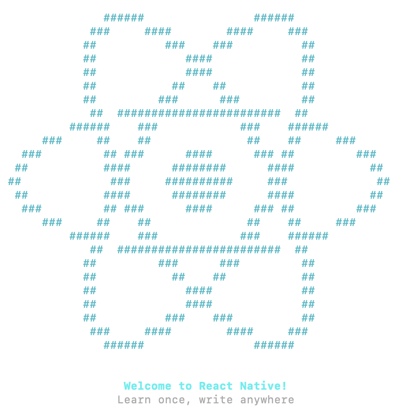

# Installation classique de React Native (référence)

Anciennes instructions d'installation, conservées pour référence. Les instructions courantes utilisent une image Docker : voir [Installation de React Native](04-2-installation-de-react-native.md).

## 2.1 React Native

React Native utilise le langage de programmation JavaScript.

Si vous avez déjà développé une application Web avec React, vous réussirez à coder en React Native rapidement.

Avec React Native, votre code vous permettra de créer une application pour Android et pour iOS mais à certaines conditions.

* Vous aurez besoin d'un ordinateur Apple pour tester et pour publier une application pour iOS.
* Il faudra probablement apporter quelques modifications au code afin de le rendre optimal pour Android ou pour iOS. Le but est d'obtenir une application qui est le plus près de l'apparence et du comportement par défaut de la plateforme.

## Pour plus d'information

* « React Native Beginners Tutorial—A Cold Dive ». Toptal. <https://www.toptal.com/react-native/cold-dive-into-react-native-a-beginners-tutorial>
* « The Ultimate React Native Tutorial ». Simpli Learn. <https://www.simplilearn.com/react-native-tutorial-article>
* « Créer une application React Native ». Grafikart. <https://grafikart.fr/tutoriels/react-native-pokedex-2245> 
* « Formation React ». Dyma. <https://dyma.fr/formations/react>

## 2.2 Installation de React Native

Vous pouvez utiliser l'éditeur de votre choix pour développer votre application mais vous aurez besoin d'Android Studio pour gérer les *émulateurs*.

Nous n'utiliserons pas [Expo](https://expo.dev/), un écosystème d'outils pour React Native. Pour comprendre ce que l'utilisation d'Expo implique, lisez ceci : <https://upstackhq.com/blog/software-development/should-i-use-expo-for-react-native>.

Dans cette fiche :

* [Programmation pour Android](#android)
* [Programmation pour iOS](#ios)
* [Installation](#installation)
* [Vérification](#verification)
* [Création d'un projet React Native](#projet)

## Programmation pour Android { #android }

Les morceaux requis sont :

* Un ordinateur Windows ou macOS
* Android Studio ou IntellilJ (requis pour construire l'application et pour fournir un émulateur)
* Node LTS
* Java SE Development Kit (JDK) - inclus avec Android Studio
* L'interface en ligne de commande de React Native (React Native CLI - Command Line Interface)
* Un IDE de votre choix

## Programmation pour iOS { #ios }

Les morceaux requis sont :

* Un ordinateur macOS
* Xcode (requis pour construire l'application et pour fournir un émulateur)
* Xcode command Line Tools
* CocoaPods
* Node
* Watchman
* Java SE Development Kit (JDK)
* L'interface en ligne de commande de React Native (React Native CLI - Command Line Interface)
* Un IDE de votre choix

## Installation { #installation }

Voici quelques précisions sur l'installation sous Windows.  Après en avoir pris connaissance, suivez les instructions d'installation pour votre système d'exploitation : <https://reactnative.dev/docs/set-up-your-environment>.

Notez qu'il est également possible d'[installer React Native dans un conteneur Docker](#docker).

* Ouvrez la fenêtre Terminal en mode administrateur.
* Effectuez cette configuration qui vous permettra de lancer des commandes dans une fenêtre Terminal :

  Terminal

  Set-ExecutionPolicy Unrestricted -Scope CurrentUser -Force

* Installez chocolatey (<https://chocolatey.org/install>) :

  Terminal

  Set-ExecutionPolicy Bypass -Scope Process -Force; [System.Net.ServicePointManager]::SecurityProtocol = [System.Net.ServicePointManager]::SecurityProtocol -bor 3072; iex ((New-Object System.Net.WebClient).DownloadString('https://community.chocolatey.org/install.ps1'))
* Installez JDK :

  Terminal

  choco install -y nodejs-lts microsoft-openjdk17
* 
Installez Git (sinon, quand on crée un projet, on obtient le message « Git is not installed on your system. This might cause some features to work incorrectly ») :

  Terminal

  choco install git.install

* Les instructions officielles demandent d'installer Android Studio en cochant Android SDK, Android SDK Platform et Android Virtual Device. Puisque vous avez déjà installé Android Studio, pas de problème. Les étapes suivantes assureront que tout est conforme en plus de compléter l'installation requise.
* Démarrez Android Studio.
* Cliquez sur les trois points verticaux sur l'écran d'accueil puis choisissez SDK Manager (ou, si un projet est déjà ouvert, File / Settings / Languages & Frameworks / Android SDK).
* Dans l'onglet SDK Platforms, cochez Show Package Details.
* Plusieurs versions du SDK peuvent coexister. Au moment d'écrire ces lignes, React Native nécessitait Android 15.   
  Cliquez sur la flèche pour développer Android 15 (VanillaIceCream). Vous devez cocher Android SDK Platform 35 puis l'un des suivants : *Intel x86_64 Atom System Image* ou, si vous désirez coder des applications qui nécessitent les API Google (Google Play Services), *Google APIs Intel x86_64 Atom System Image*.
* Cliquez sur l'onglet SDK Tools.
* Cochez Show Package Details.
* Cliquez sur la flèche pour développer Android SDK Build-Tools puis cochez 36.0.0.
* Cliquez sur la flèche pour développer Android SDK Command-line Tools (latest) puis cochez Android SDK Command-line Tools (latest).
* Plus bas, cochez Android Emulator et Android SDK Platform-Tools.
* Cliquez sur Apply pour lancer l'installation.
* Notez le chemin du SDK Android qui est affiché dans le haut de l'écran. Ex : C:\Users\MonNom\AppData\Local\Android\Sdk. Ce chemin peut être retrouvé dans Android Studio à partir du menu Tools / SDK Manager / Languages & Frameworks / Android SDK, dans la zone Android SDK Location.
* Faites pointer la variable d'environnement ANDROID\_HOME vers le dossier du SDK Android (vous pouvez utiliser %USERPROFILE% au lieu de C:\Users\MonNom).
* Modifiez la variable d'environnement PATH pour lui ajouter le dossier %LOCALAPPDATA%\Android\Sdk\platform-tools.
* Pour configurer l'émulateur qui sera utilisé pour tester vos applications, ouvrez un projet bidon dans Android Studio.
* [Créer un nouveau périphérique virtuel](06-4-les-émulateurs-et-appareils-physiques.md#liste) qui utilise l'image système VanillaIceCream (API 35).
* Pour éditer vos applications, si vous désirez utiliser VSCode, il est conseillé d'installer l'extension React Native Tools.
* Maintenant que vous avez pris connaissance de ces précisions, suivez les instructions d'installation pour votre système d'exploitation : <https://reactnative.dev/docs/set-up-your-environment>.

## Vérification { #verification }

Avant de poursuivre, effectuez les vérifications suivantes pour vous assurer que tout est correctement en place.

* Vérifiez que les variables d'environnement sont bien mises à jour en entrant ces commandes dans une nouvelle fenêtre Terminal (les changements ne sont pas effectifs dans les fenêtres qui étaient ouvertes avant les modifications) :

  Terminal

  $ENV:ANDROID\_HOME  
  $ENV:PATH
* Vérifiez version de Node :

  Terminal

  node -v

  Vous devez avoir la version 18 ou plus récent.
* Vérifiez la version de Java :

  Terminal

  java --version

  Vous devez avoir la version 17 ou moins.

## Création d'un projet React Native { #projet }

Vous êtes maintenant prêts à [créer votre premier projet React Native](05-3-création-et-lancement-dun-projet-react-native.md#base).
